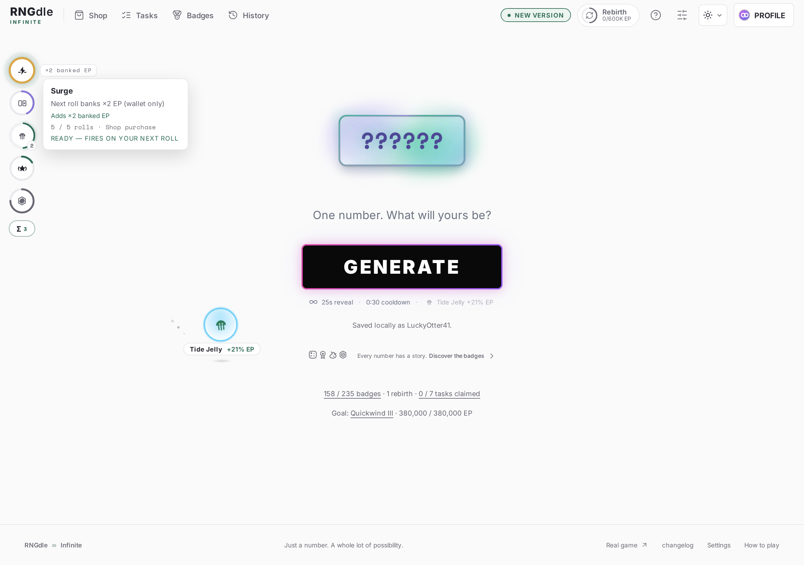
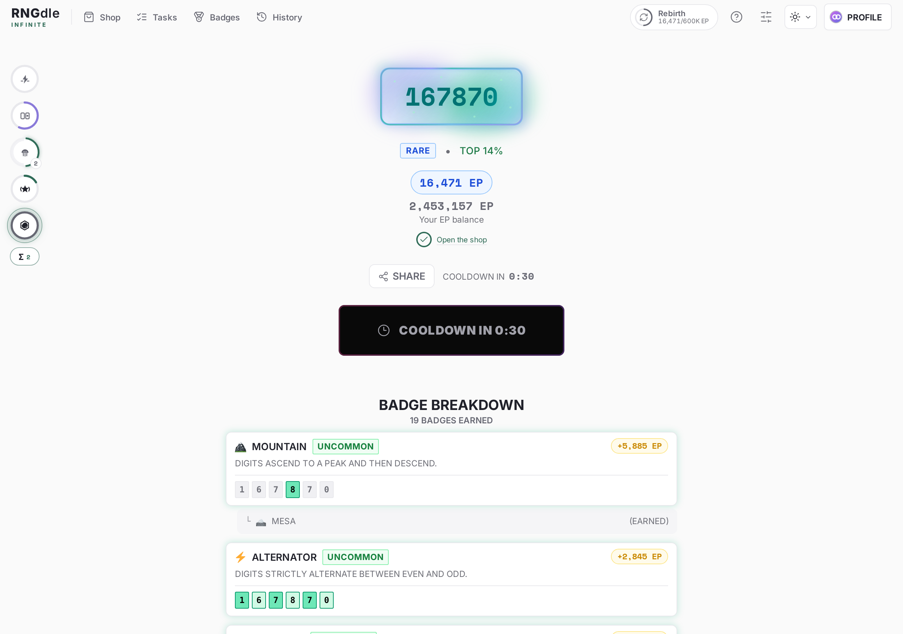
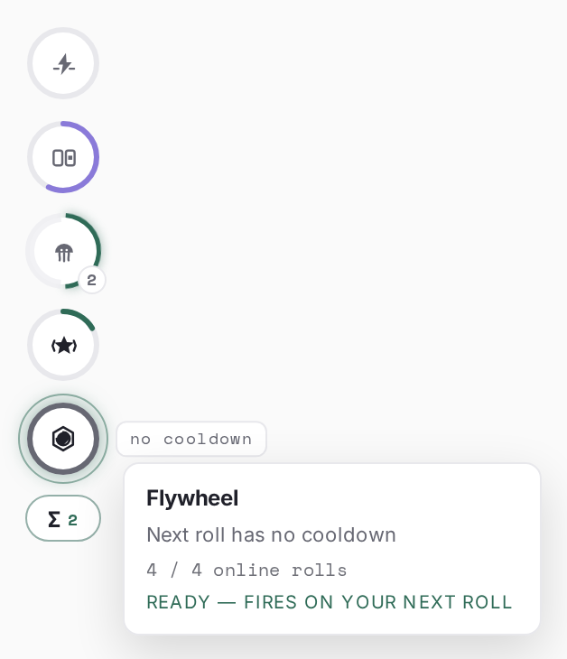

# RNGdle Infinite

**Roll a number from 0 to 1,000,000. Find out what makes it special.**

A free browser game about rolling numbers, earning EP, collecting badges and
buying upgrades. Play without an online account; local profiles save in this
browser, and configured deployments can sync one save across devices.

  <a href="https://jaime-gaming.github.io/RNGdle-Infinite/"><strong>▶ Play now</strong></a>
  · works on desktop and mobile · local play needs no sign-in

---

**Contents:** [How to play](#how-to-play) · [Ways to grow](#ways-to-grow) ·
[Online accounts and cloud saves](#online-accounts-and-cloud-saves) ·
[Legacy records](#legacy-records) · [FAQ](#faq) · [Credits](#credits)

## How to play

1. **Roll.** Press **GENERATE** and get a random whole number from 0 to
   1,000,000.
2. **Score.** The number earns EP from its patterns: pairs, runs, lucky sevens
   and many more. Each pattern is a **badge** for your collection.
3. **Wait.** A short reveal and a cooldown keep things paced. Upgrades make
   both shorter.
4. **Spend.** EP is your wallet. Buy upgrades, companions and skills to roll
   faster and earn more.

## Ways to grow

|                 | What it does                                                                                                                           |
| --------------- | -------------------------------------------------------------------------------------------------------------------------------------- |
| **Companions**  | Thirteen friends that multiply the EP you earn. Wear one at a time; some can be found for free while you roll.                         |
| **Skills**      | Charged effects that fire on your next roll: double EP, extra draws, no cooldown and more. Skills never change how a number is scored. |
| **Tasks**       | Daily and weekly goals that pay EP.                                                                                                    |
| **Badges**      | A collection to fill, with rarities from Common to GODLY. Roll an exact number twice and the box wears a déjà vu look.                 |
| **Rebirth**     | Start over with a permanent bonus.                                                                                                     |
| **Prestige**    | A bigger fresh start, once you own half the collection and have earned 30 million EP in the cycle.                                     |
| **Rollback**    | A secret that appears after three prestiges. It can be repeated.                                                                       |
| **Fresh start** | Offered once you have three prestiges: wipe the run and the ladder, keep your profile and every aura.                                  |
| **Profile**     | Lives at `/profile/your-name`: best roll, up to ten pinned rolls, four key figures, what you wear and a PNG card to share.             |

## Online accounts and cloud saves

An online account is optional. Local profiles continue to work in the browser;
sign in with Google or email/password to keep a cloud save across devices. If
you already use email/password, sign in first and choose **Connect Google** to
link both methods to the same Firebase account and save.

If the Firebase account has no save yet, an unowned local save can be imported.
For saves with the same game profile, a clearly dominant save can sync
automatically only when both saves are from the same reset generation. If the
generations differ, the game explains the reset history and asks you which save
to keep—neither the later generation nor the
cloud copy wins automatically. Within one generation, a clear lead in measured
game progress can decide the sync; a tie or mixed/incomparable progress always
asks you to choose. The comparison uses gameplay progress such as earned EP,
rebirth/prestige/reset milestones, rolls, achievements, owned upgrades, skills,
companions and best roll—not file size, timestamps, history length or profile
preferences. Different game profiles cannot be compared or merged; when both
copies are eligible but have different profile IDs, review them as incomparable
and choose one complete save to keep. A save owned by a different Firebase
account is never imported. Local progress continues to be saved in the browser,
and before an overwrite the displaced version is kept separately under
**Settings → Cloud conflict recovery**. Signing out keeps the
local browser copy. Deleting the game save removes that Firebase user's
Firestore document, but not the Firebase sign-in itself.

### Firebase setup

The app is configured for Firebase project `rngdle-infinite-jg`. The public
Web SDK values are in `.env.production` for production/GitHub Pages builds and
in `.env.example` for local development; they are not service-account
credentials. The game uses Firebase Authentication and Cloud Firestore, not
Firebase Analytics or Cloud Storage. Firestore stores a compressed snapshot at
`player_saves/{uid}` to stay below its 1 MiB document limit.

In Firebase Authentication, Email/Password must be enabled; Google sign-in is
already enabled for project `rngdle-infinite-jg`. For another project, enable
both providers and add `jaime-gaming.github.io` and `localhost` to its
authorized domains. Create a Firestore database in a European region and
publish [`firestore.rules`](firestore.rules). Those rules let a signed-in user
read and write only the document whose ID is their Firebase UID. Do not use
open/test-mode rules or a service-account key in the browser.

This is a fresh Firebase setup: existing Supabase accounts and cloud saves are
left in the old project and are not migrated. Players need Firebase accounts;
old Supabase-owned browser saves are not silently copied into another account.
The Supabase migration file remains only as historical reference and is not
used by this build.

For local development, copy `.env.example` to the ignored `.env.local`, then run
`npm run dev`. Production builds and `npm run pages:publish` use the public
configuration in `.env.production`, so the generated `docs/` site is ready for
Firebase. If the Firebase values are absent or invalid in a development build,
local play remains available but cloud sign-in is disabled.

## Legacy records

RNGween 2026 gameplay and its seasonal interface have retired. The event shop,
tasks and World are no longer playable. Permanent auras already earned,
Hexbound, Hollow Lantern, attendance stamps and historical activity remain in
old saves; these rewards are preserved as legacy cosmetics and are not available
to earn again.

## FAQ

**Is there a roll limit?** No. Roll as often as you like once the reveal and
cooldown finish.

**Can I pick a specific number?** No. There is no seed, editor or preset.

**Does a companion make my rolls luckier?** No. Companions multiply the EP you
earn. Your number and its badges stay the same.

**Do offline rolls count?** Yes: they pay EP and show up in your history. Skills
only charge while you are online, though.

**What happens if I clear my browser data?** If you have an online account and a
cloud save, sign in again to restore it. Otherwise the browser-only save is
removed with the site data. Export a profile card for a record, but it cannot be
imported into a game save.

**Is this the official RNGdle?** No. It is an independent recreation; see the
credits below.

## Credits

- [RNGdle](https://www.rngdle.com/) by Cam / sparrowpatch — the original idea.
- [RNGdle Tools](https://rng.cubityfir.st/) and its badge catalogue, the source
  of the scoring and rank data.
- Badge artwork by [Twemoji](https://github.com/jdecked/twemoji),
  [CC BY 4.0](https://creativecommons.org/licenses/by/4.0/).
- Fonts: Inter and Space Mono (SIL Open Font License). Icons: [Lucide](https://lucide.dev/).
