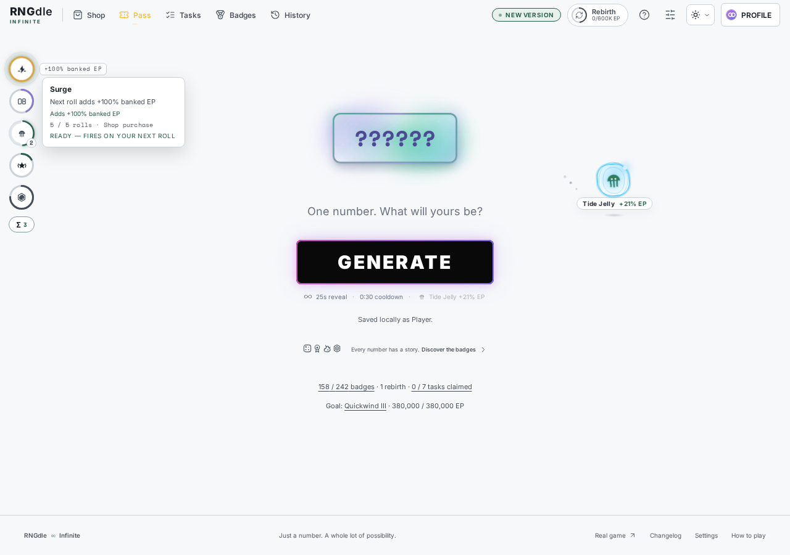
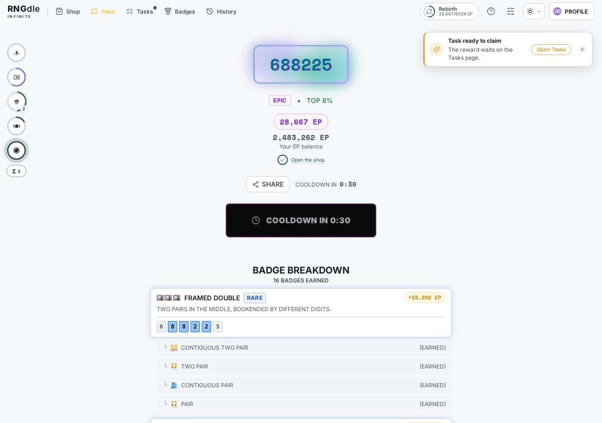
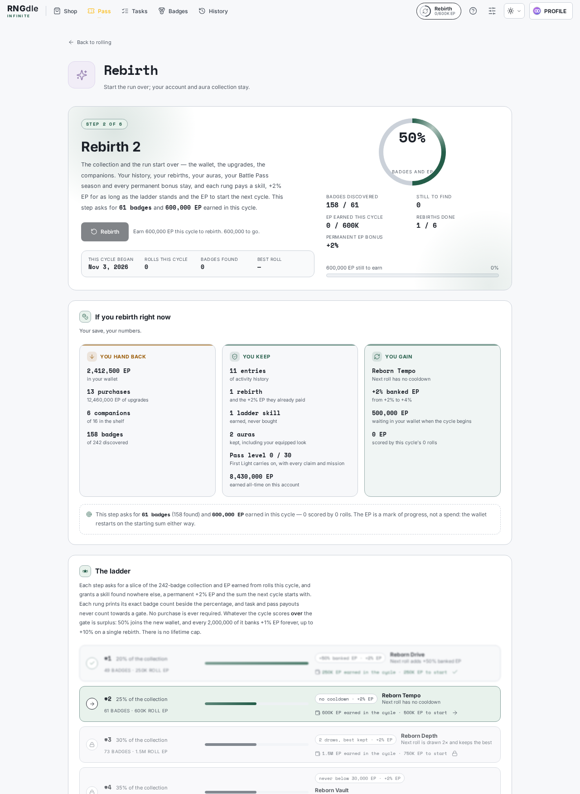
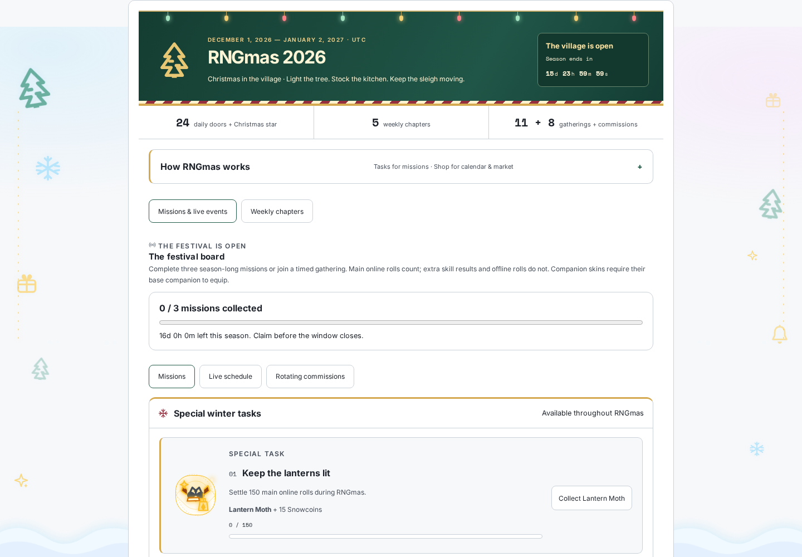
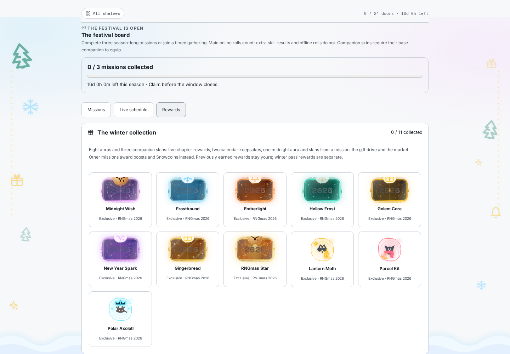
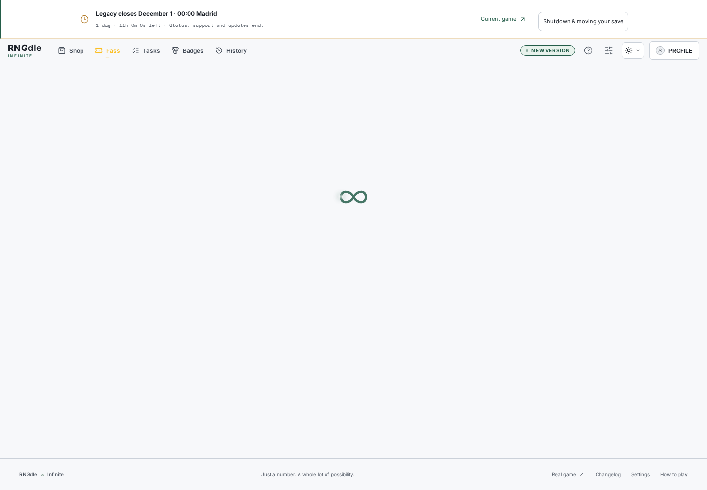
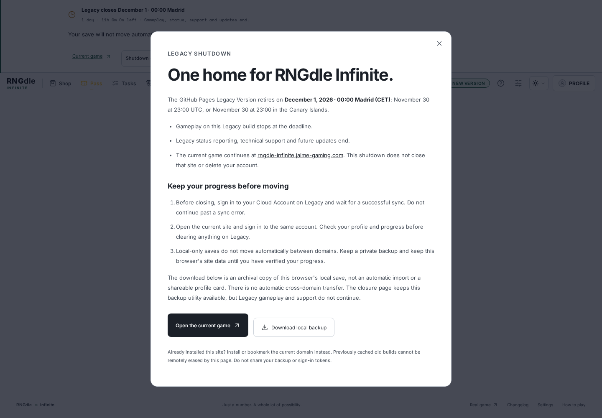
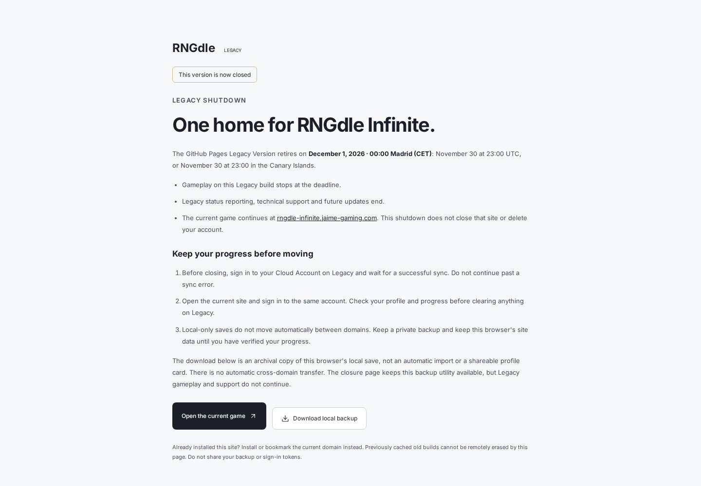
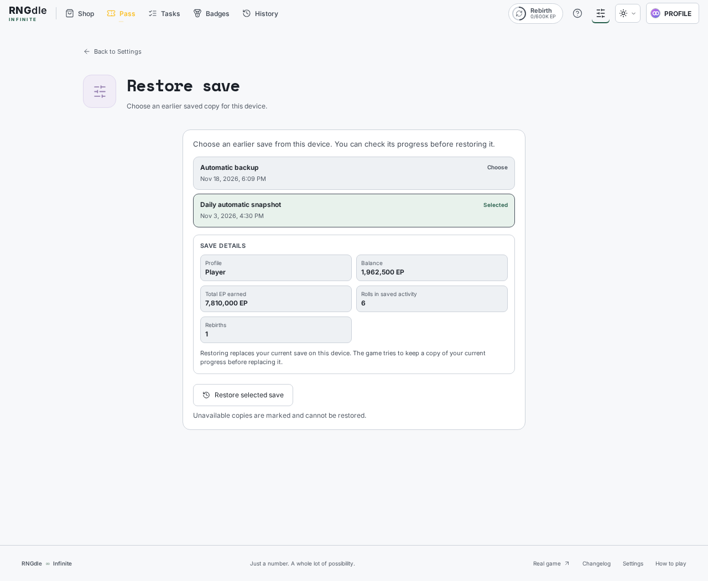

# RNGdle Infinite

**Roll one number. Discover what makes it special.**

RNGdle Infinite is a free browser game about surprising numbers, collectible badges, and building a run at your own pace.

<p align="center">
  <a href="https://rngdle-infinite.jaime-gaming.com/"><strong>▶ Play now</strong></a>
</p>

[How to play](#how-to-play) · [What you can discover](#what-you-can-discover) · [Battle Pass](#battle-pass) · [RNGmas 2026](#rngmas-2026) · [Legacy shutdown](#legacy-shutdown) · [Keep your progress](#keep-your-progress) · [FAQ](#faq) · [Privacy & contact](#privacy--contact) · [Run locally](#run-locally) · [Contributing](CONTRIBUTING.md) · [Security](SECURITY.md) · [Changelog](CHANGELOG.md) · [Credits](#credits)



> **GitHub Pages Legacy closes December 1, 2026 at 00:00 Madrid (CET).** The current domain stays online. [Shutdown details and moving your save](#legacy-shutdown).

## How to play

1. **Roll** a number from 0 to 1,000,000.
2. **Discover** the patterns and curiosities that make it stand out.
3. **Collect EP** and spend it on upgrades, skills, companions, and auras.
4. **Keep going:** tasks, badges, and fresh starts give every run something to chase.



## What you can discover

- **Badges** for patterns, famous numbers, and mathematical curiosities.
- **Companions** that boost the EP you earn.
- **Skills and upgrades** that change the pace of a run, never the odds. Wallet-skill bonuses add together instead of multiplying each other; draw skills share a six-draw limit.
- **Daily and weekly tasks**, a long-term badge collection, and new milestones.
- **Auras** to change the look of your game, plus a history of your rolls. Keep up to 25 bookmarks; profiles show the first ten with an option to show all.




## Battle Pass

Each Battle Pass season has its own published dates. **First Light** starts
November 18, 2026 at 00:00 UTC. Every pass mission — daily, weekly and season
milestones — lives on
the **Tasks** page and pays **BPEP**, which only moves the pass; EP remains your
shop wallet. The Pass page shows the vertical reward track across 30 levels.
Levels 5, 15 and 25 grant consumable boosts: **Spark Injector** banks ×1.5 EP
for 15 minutes, **Surge Capacitor** ×2 for 10 minutes, and **Overdrive Cell**
×2.5 for 5 minutes. One
charge per day can also be bought for 250,000 EP. A matching charge extends a
running window without multiplying the bonus a second time. The optional
premium track costs EP, never real money. Earned rewards are kept; unclaimed earned rewards
arrive when the season closes. Rebirth never resets the pass, and the cosmetics
you claim are yours forever.

## RNGmas 2026

From **December 1, 2026 to January 2, 2027 (UTC)**, RNGdle Infinite runs RNGmas: an advent calendar and five weekly activities. Frostfall and the RNGmas pass also open on December 1, when First Light closes, and last until January 2. During December 1–January 2 UTC only, toggle decorations independently of your color theme with **Christmas mode**, under **TEMPORAL** in Appearance. Outside that season the switch is disabled and decorations cannot activate. Snow, lights and scenery adapt to phones, tablets and desktops; reduced-motion preferences are respected.

Find all event missions, live gatherings and weekly chapters in **Tasks → RNGmas**. The shop contains the Advent calendar, reward gallery, market and exchange. The festival now includes **8 event auras and 5 companion skins**, plus the **3 winter-pass cosmetics**. Alongside the five weekly zones, a festival board gives you season-long tasks and four scheduled live activities with personal progress—not invented global player counts.

**Special tasks.** Settle 150 primary online rolls for Lantern Moth; find 25 numbers containing a 7 for two Spark charges; collect all ten final digits for one Surge charge. Claim during RNGmas for the reward and 15/20/25 Snowcoins respectively. Auto-Roll counts; offline and extra skill results do not.

**Live gatherings (UTC, end exclusive).** These activities must be completed and claimed within their window:

| Activity              | Window                        | Goal                                          | Exclusive aura |
| --------------------- | ----------------------------- | --------------------------------------------- | -------------- |
| Meteor watch          | Dec 4, 18:00 – Dec 7, 00:00   | 30 even primary online rolls                  | Starfall Snow  |
| Bell relay            | Dec 11, 18:00 – Dec 14, 00:00 | Eight distinct final digits                   | Carol Circuit  |
| Northbound gift drive | Dec 18, 18:00 – Dec 21, 00:00 | Four in-game parcels costing 5 Snowcoins each | Parcel Kit     |
| Midnight wishes       | Dec 31, 18:00 – Jan 1, 02:00  | Ten primary online rolls of at least 500,000  | Midnight Wish  |

The market offers **Polar Axolotl (100 Snowcoins)** once. The reward gallery previews eight auras and five companion skins. Previously earned auras stay yours. Skins need their base companion and do not change stats or odds.

**Advent calendar.** A new door opens every day from December 1. Claim it on that UTC day or lose it; there is no catch-up. The last door holds the Gingerbread aura,
and the RNGmas Star is claimable only on Christmas Day.

**Weekly activities.** Golem Smash (December 1–8), Christmas market (December 8–15), Snowcoin exchange (December 15–22), Gift workshop (December 22–29, 80 online numbers containing 0) and Midnight countdown (December 29–January 2, 100 online rolls). Each chapter is an expandable zone in Tasks → RNGmas → Weekly chapters; the live one opens by default. Claim during its week for a permanent aura, Snowcoins and a themed boost bundle:

| Chapter            | Extra rewards alongside the permanent aura            |
| ------------------ | ----------------------------------------------------- |
| Golem Smash        | 50 Snowcoins + 2 Overdrive Cell charges               |
| Christmas market   | 15 Snowcoins + 2 Spark Injector charges               |
| Snowcoin exchange  | 25 Snowcoins + 2 Surge Capacitor charges              |
| Gift workshop      | 35 Snowcoins + 2 Surge Capacitor charges + 150,000 EP |
| Midnight countdown | 50 Snowcoins + 3 Overdrive Cell charges + 200,000 EP  |

The winter trail combines RNGween-style missions and aura previews with Black Friday-style offer cards and a stall-visit passport. Previously claimed rewards remain yours; the redesigned bundles cannot be claimed again on old completion receipts.

**Snowcoins.** Earn one per primary online roll, including Auto-Roll; offline and extra skill results do not count. From December 8 the market sells five one-time boost offers (10–90 Snowcoins) and a permanent Polar Axolotl skin (100 Snowcoins); buy from any three stalls during that week for Emberlight. From December 15, exchange 10,000 EP per Snowcoin, up to 200 coins across the event; exchange 100 during that week for Frostbound. Both services stay open until January 2, but weekly aura claims expire with their chapter. There is no EP cash-out. Wallets and purchase receipts survive resets; unspent coins stop being usable after the event.

**Golem Smash, December 1–8.** Prepare a strike for 100,000 EP. Your next normal online number deals that much damage to the 25,000,000-HP golem: 0–1,000,000 per strike, averaging 500,000. No multipliers, no extra skill hits and no offline damage. A prepared strike survives reloads. Expect about 50 strikes (5,000,000 EP); no fixed maximum is promised.

Nothing here changes roll odds, scoring tables, badge values or cooldowns; earned auras stay in your collection forever.





_Seasonal preview with a synthetic local profile, December 17 UTC. Captures illustrate this development branch, not proof of a live deployment._

## Legacy shutdown

The GitHub Pages Legacy Version at `jaime-gaming.github.io/RNGdle-Infinite/` closes **December 1, 2026 at 00:00 Europe/Madrid**, which is **November 30 at 23:00 UTC** (23:00 in the Canary Islands). Legacy gameplay, status reporting, support and updates end. The current game at [rngdle-infinite.jaime-gaming.com](https://rngdle-infinite.jaime-gaming.com/) continues.

A permanent countdown banner links to **Shutdown & moving your save**. At the deadline this build switches to a closure page instead of mounting the game. A private local-backup download remains available without erasing site data.

**Move before closing:** wait for a successful Cloud sync on Legacy, open the current site with the same account and verify your profile/progress before clearing anything. Local-only browser saves do not transfer automatically between domains. The backup is an archival copy, not an automatic import. Full instructions, preview commands and deployment caveats are in [the shutdown plan](docs-source/legacy-shutdown.md).







_These are development previews with synthetic local data, not evidence of a production deployment. Old cached offline builds cannot be remotely erased by a new client build._

## Keep your progress

Open **Profile → Continue locally**, then give your local profile a name to keep your progress on this device. A Cloud Account is optional if you want to continue on another device. If you play offline, progress is saved locally and a Cloud Account syncs again when you reconnect.

When two devices hold different progress for the same profile, the copy with more progress is kept automatically and the other copy stays safe here; you are asked when the copies belong to different game profiles. You choose whether to share a public profile: **Make profile public** either publishes the summary or explains what stopped it, and a name that belongs to another Cloud account is reported instead of failing quietly. A profile logo appears only when that profile is shared. To go back to an earlier saved copy, open **Settings → Restore save**; you can check the copy's progress before choosing it.



Your progress is saved in this browser. Keep the site data on this device; if saving stops, check that the device has available storage.

## FAQ

**Does anything change the odds?** No. Every number has the same chance, and companions or upgrades never improve your luck.

**Can I choose a number?** No. Each roll is random; repeats are part of the game.

**Can I play offline?** Yes. Your named local profile keeps progress on this device; cloud progress syncs after you reconnect. Offline Roller rewards are shown on their own full-screen summary when you come back, and they stay readable until you close it.

**What happens to old event rewards?** Rewards already earned remain in your collection and activity history.

**Is this the original RNGdle?** No. This is an independent game inspired by the original.

## Privacy & contact

Read [Privacy & Rights](https://rngdle-infinite.jaime-gaming.com/privacy) and the [Terms of Service](https://rngdle-infinite.jaime-gaming.com/tos). Implementation notes on Cloud roll verification, its current limits, reference codes, and deployment are in [Cloud game security](docs/cloud-game-security.md). Questions? Email [jaimegamingpro@gmail.com](mailto:jaimegamingpro@gmail.com).

## Run locally

### Requirements and installation

Use **Node.js 22 or newer**, npm and a modern browser. The development server
binds to `0.0.0.0`, so avoid exposing it on an untrusted network.

```sh
git clone https://github.com/jaime-gaming/RNGdle-Infinite.git
cd RNGdle-Infinite
npm ci
npm run dev:test
```

Open the URL Vite prints (normally `http://localhost:5173`), select **Continue
locally** in Profile and create a local profile. No Firebase credentials are
needed in this mode. The checked-in test environment pins the preview clock to
November 18, 2026; Playwright overrides it for deterministic fixtures. In a POSIX
shell, use the real clock with `VITE_GAME_PREVIEW_AT=0 npm run dev:test`, or
preview RNGmas with
`VITE_GAME_PREVIEW_AT=1797465600000 npm run dev:test` (December 17 UTC).
In PowerShell, set `$env:VITE_GAME_PREVIEW_AT="0"` before `npm run dev:test`
instead. Production builds ignore this preview override.

### Build and preview

```sh
npm run build
npm run preview
```

The production build is written to `dist/`; Vite prints the preview URL, normally
`http://localhost:4173`. This previews static assets, **not** a fully configured
Cloudflare backend. `npm run test:worker` exercises the Worker artifact locally.
Do not interpret a static preview as verification of Firebase or production
secrets. The legacy mirror uses `npm run build:github-pages` to generate `docs/`
with the `/RNGdle-Infinite/` base path; do not edit generated bundles by hand.

### Optional Cloud development

`npm run dev` loads the checked-in development Firebase Web configuration and
can contact the real project. For experiments, use a separate test Firebase
project and an ignored `.env.local`, using `.env.example` as the variable list.
Configure Authentication providers/authorized domains and Firestore rules for
that **test** project first. Never copy service-account JSON into `.env.local`
or any `VITE_` variable. Firebase Web configuration is public client data, not a
server credential. `.env.local` also affects other Vite modes, so keep it out of
local-only tests if it supplies Firebase settings.

Authenticated roll endpoints additionally require the Worker, Durable Object
binding and server-only secrets described in
[Cloud game security](docs-source/cloud-game-security.md). Publishing Firestore
rules or deploying a Worker is a separate, explicitly authorized operation.

### Checks and screenshots

```sh
npx playwright install chromium
npm run test:render
npm run verify:cloud
npm run verify:release
npm test
```

Tests start a local-only server on port 5174. On Linux, Playwright may need system
dependencies (`npx playwright install --with-deps chromium`); an existing browser
can be selected through `CHROMIUM_PATH`. See [CONTRIBUTING.md](CONTRIBUTING.md)
for change-specific checks. With a local-only dev server running, regenerate the
base README captures using `npm run screenshots`; set `SCREENSHOT_BASE` to its
URL if it is not `http://127.0.0.1:5174`. The seasonal capture is generated by
`node tools/screenshot-rngmas.mjs` against the same server, using synthetic data
and a fixed December 17 UTC clock. Use `VITE_GAME_PREVIEW_AT=0` on that server
when reproducing the seasonal capture.

## License and project policies

No project-wide source-code license is currently declared. Contact the
maintainer before assuming reuse or redistribution rights. A license must be
chosen explicitly; this documentation does not add one. Third-party artwork,
fonts and packages retain their own terms, documented in
[THIRD_PARTY_NOTICES.md](THIRD_PARTY_NOTICES.md).

- [Contribution guide](CONTRIBUTING.md)
- [Private security reporting](SECURITY.md)
- [Release history and development notes](CHANGELOG.md)
- [Repository checklist and metadata proposals](docs-source/repository-checklist.md)

## Credits

- The original [RNGdle](https://www.rngdle.com/) by Cam / sparrowpatch.
- Badge references from [RNGdle Tools](https://rng.cubityfir.st/).
- Badge artwork by [Twemoji](https://github.com/jdecked/twemoji), [CC BY 4.0](https://creativecommons.org/licenses/by/4.0/).
- Fonts: Inter and Space Mono. Icons: [Lucide](https://lucide.dev/).

_Documentation reviewed November 22, 2026._
