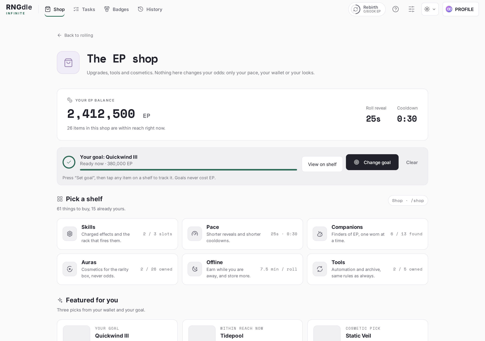
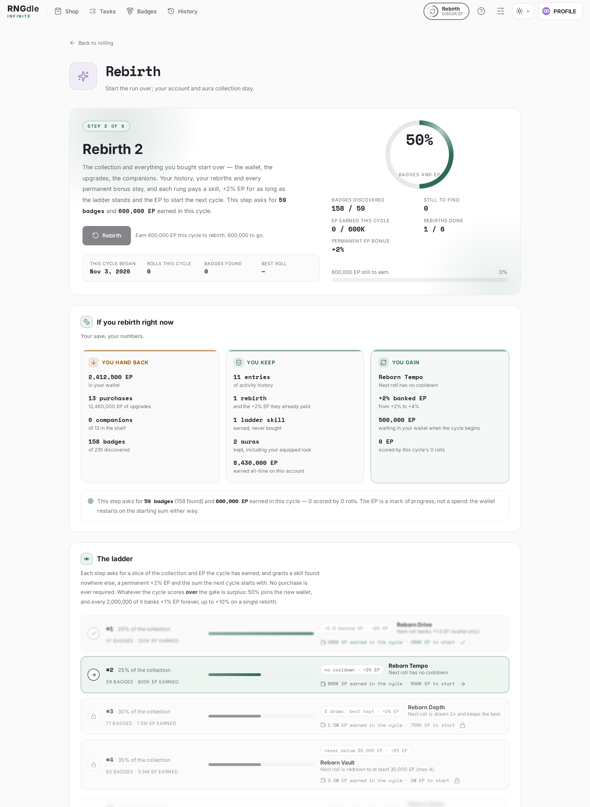
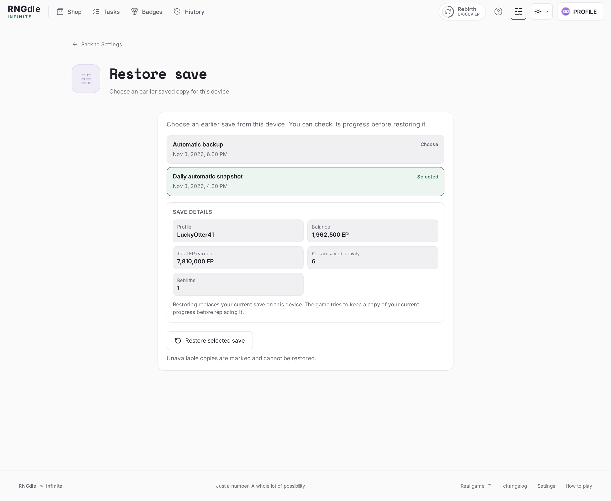

# RNGdle Infinite

**Roll one number. Discover what makes it special.**

RNGdle Infinite is a free browser game about surprising numbers, collectible badges, and building a run at your own pace.

  <a href="https://jaime-gaming.github.io/RNGdle-Infinite/"><strong>▶ Play now</strong></a>
  · <a href="https://rngdle-infinite.jaime-gaming.com/">Open the game</a>

## How to play

1. **Roll** a number from 0 to 1,000,000.
2. **Discover** the patterns and curiosities that make it stand out.
3. **Collect EP** and spend it on upgrades, skills, companions, and auras.
4. **Keep going:** tasks, badges, and fresh starts give every run something to chase.

## What you can discover

- **Badges** for patterns, famous numbers, and mathematical curiosities.
- **Companions** that boost the EP you earn.
- **Skills and upgrades** that change the pace of a run, never the odds.
- **Daily and weekly tasks**, a long-term badge collection, and new milestones.
- **Auras** to change the look of your game, plus a history of your rolls.

## Keep your progress

Give your local profile a name and your progress stays on this device. A Cloud Account is optional if you want to continue on another device. If you play offline, progress is saved locally and a Cloud Account syncs again when you reconnect.

You choose whether to share a public profile. A profile logo appears only when that profile is shared. To go back to an earlier saved copy, open **Settings → Restore save**; you can check the copy's progress before choosing it.

## FAQ

**Does anything change the odds?** No. Every number has the same chance, and companions or upgrades never improve your luck.

**Can I choose a number?** No. Each roll is random; repeats are part of the game.

**Can I play offline?** Yes. Your named local profile keeps progress on this device; cloud progress syncs after you reconnect.

**What happens to old event rewards?** Rewards already earned remain in your collection and activity history.

**Is this the original RNGdle?** No. This is an independent game inspired by the original.

## Privacy & contact

Read [Privacy & Rights](https://jaime-gaming.github.io/RNGdle-Infinite/privacy) and the [Terms of Service](https://jaime-gaming.github.io/RNGdle-Infinite/tos). Questions? Email [jaimegamingpro@gmail.com](mailto:jaimegamingpro@gmail.com).

## Credits

- The original [RNGdle](https://www.rngdle.com/) by Cam / sparrowpatch.
- Badge references from [RNGdle Tools](https://rng.cubityfir.st/).
- Badge artwork by [Twemoji](https://github.com/jdecked/twemoji), [CC BY 4.0](https://creativecommons.org/licenses/by/4.0/).
- Fonts: Inter and Space Mono. Icons: [Lucide](https://lucide.dev/).

_Updated November 3, 2026._
