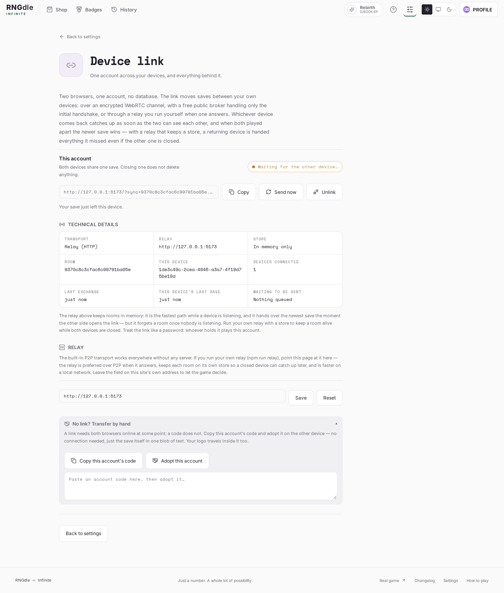

# RNGdle Infinite

**Roll a number from 0 to 1,000,000. Find out what makes it special.**

A free browser game about rolling numbers, earning EP, collecting badges and
buying upgrades. No energy meter, no daily limit, no account needed.

  <a href="https://jaime-gaming.github.io/RNGdle-Infinite/"><strong>▶ Play now</strong></a>
  · works on desktop and mobile · saves in your browser

---

**Contents:** [How to play](#how-to-play) · [Ways to grow](#ways-to-grow) ·
[RNGween](#rngween-october-21--november-3-2026) · [Your progress](#your-progress) ·
[FAQ](#faq) · [Credits](#credits)

## How to play

1. **Roll.** Press **GENERATE** and get a random whole number from 0 to
   1,000,000.
2. **Score.** The number earns EP from its patterns: pairs, runs, lucky sevens
   and many more. Each pattern is a **badge** for your collection.
3. **Wait.** A short reveal and a cooldown keep things paced. Upgrades make
   both shorter.
4. **Spend.** EP is your wallet. Buy upgrades, companions and skills to roll
   faster and earn more.

## Ways to grow

|                | What it does                                                                                                                           |
| -------------- | -------------------------------------------------------------------------------------------------------------------------------------- |
| **Companions** | Thirteen friends that multiply the EP you earn. Wear one at a time; some can be found for free while you roll.                         |
| **Skills**     | Charged effects that fire on your next roll: double EP, extra draws, no cooldown and more. Skills never change how a number is scored. |
| **Tasks**      | Daily and weekly goals that pay EP.                                                                                                    |
| **Badges**     | A collection to fill, with rarities from Common to GODLY.                                                                              |
| **Rebirth**    | Start over with a permanent bonus.                                                                                                     |
| **Prestige**   | A bigger fresh start, once you own half the collection and have earned 30 million EP in the cycle.                                     |
| **Rollback**   | A secret that appears after three prestiges. It can be repeated.                                                                       |

## RNGween (October 21 – November 3, 2026)

A one-off Halloween event. All dates are UTC and come from the website's clock,
so changing your phone's date does nothing.

- **The look.** Webs, lanterns and a dark palette, with a Halloween switch in
  the Appearance menu. It only shows on the dark theme.
- **Limited Shop.** Trade 10,000 EP for 1 Pumpkoin (no refunds) and spend them
  on a pumpkin companion, a seasonal skill, a World key or the event auras.
  Unspent coins vanish when the shop closes.
- **Halloween tasks (Oct 25–31).** Four goals — 200 rolls, 40 Rare+, 5,000,000
  EP and 18 task claims, all online — unlock **Jack-o'-Glow, Phantom Veil,
  Witchfire** and **Blood Moon** for free. On the other days, hourly tasks pay
  Pumpkoins instead: four at a time, one hour each, no skips.
- **RNGween World.** Talk to the Reaper at the foot of the Roll page. Four
  haunted zones with their own badges, fragments that forge a key to the Valley
  of Horrors, and a hidden **Hexbound** aura for rolling 6666.
- **What stays.** The auras you collected are yours forever, through Rebirth,
  Prestige and Rollback. Everything else retires on November 4, and the auras
  never return.

## Your progress

Your save lives in your browser, so there is nothing to sign up for.

**Playing on two devices.** Open **Settings → Device link** on one device and
open the link (or scan the QR code) on the other. While both are open they stay
in sync. The device that created the link is the main one: it runs rolls and
purchases, so the two screens never fight over the same roll. Anyone with the
link can play your account, so keep it private.

## FAQ

**Is there a roll limit?** No. Roll as often as you like once the reveal and
cooldown finish.

**Can I pick a specific number?** No. There is no seed, editor or preset.

**Does a companion make my rolls luckier?** No. Companions multiply the EP you
earn. Your number and its badges stay the same.

**Do offline rolls count?** Yes: they pay EP and show up in your history. Skills
only charge while you are online, though.

**What happens if I clear my browser data?** The save goes with it. Link a
second device first if you want a copy.

**Is this the official RNGdle?** No. It is an independent recreation; see the
credits below.

## Credits

- [RNGdle](https://www.rngdle.com/) by Cam / sparrowpatch — the original idea.
- [RNGdle Tools](https://rng.cubityfir.st/) and its badge catalogue, the source
  of the scoring and rank data.
- Badge artwork by [Twemoji](https://github.com/jdecked/twemoji),
  [CC BY 4.0](https://creativecommons.org/licenses/by/4.0/).
- Fonts: Inter and Space Mono (SIL Open Font License). Icons: [Lucide](https://lucide.dev/).
