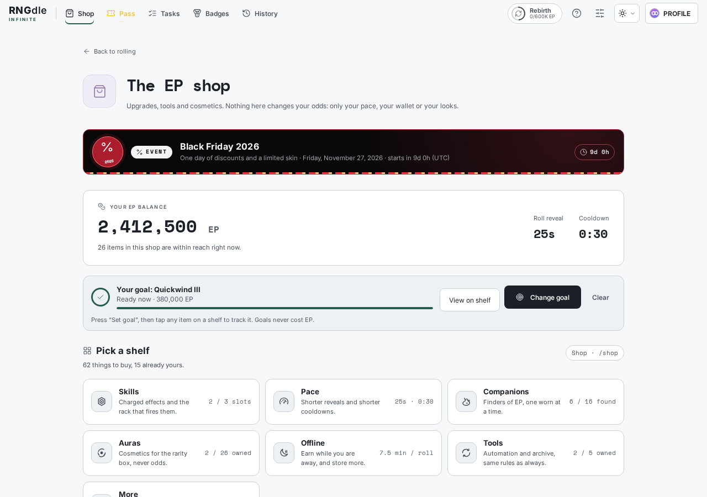

# RNGdle Infinite

**Roll one number. Discover what makes it special.**

RNGdle Infinite is a free browser game about surprising numbers, collectible badges, and building a run at your own pace.

  <a href="https://rngdle-infinite.jaime-gaming.com/"><strong>▶ Play now</strong></a>

[How to play](#how-to-play) · [What you can discover](#what-you-can-discover) · [Battle Pass](#battle-pass) · [RNGmas 2026](#rngmas-2026) · [Keep your progress](#keep-your-progress) · [FAQ](#faq) · [Privacy & contact](#privacy--contact) · [Credits](#credits)

## How to play

1. **Roll** a number from 0 to 1,000,000.
2. **Discover** the patterns and curiosities that make it stand out.
3. **Collect EP** and spend it on upgrades, skills, companions, and auras.
4. **Keep going:** tasks, badges, and fresh starts give every run something to chase.

## What you can discover

- **Badges** for patterns, famous numbers, and mathematical curiosities.
- **Companions** that boost the EP you earn.
- **Skills and upgrades** that change the pace of a run, never the odds. Wallet-skill bonuses add together instead of multiplying each other; draw skills share a six-draw limit.
- **Daily and weekly tasks**, a long-term badge collection, and new milestones.
- **Auras** to change the look of your game, plus a history of your rolls.

## Battle Pass

Each Battle Pass season has its own published dates. **First Light** starts
November 18, 2026 at 00:00 UTC. Every pass mission — daily, weekly and season
milestones — lives on
the **Tasks** page and pays **BPEP**, which only moves the pass; EP remains your
shop wallet. The Pass page shows the vertical reward track across 30 levels.
Levels 5, 15 and 25 grant consumable boosts: **Spark Injector** banks ×1.5 EP
for 15 minutes, **Surge Capacitor** ×2 for 10 minutes, and **Overdrive Cell**
×2.5 for 5 minutes. One
charge per day can also be bought for 250,000 EP. A matching charge extends a
running window without multiplying the bonus a second time. The optional
premium track costs EP, never real money. Earned rewards are kept; unclaimed earned rewards
arrive when the season closes. Rebirth never resets the pass, and the cosmetics
you claim are yours forever.

## RNGmas 2026

From **December 1, 2026 to January 2, 2027 (UTC)**, RNGdle Infinite runs RNGmas: an advent calendar and five weekly golems. Frostfall and the RNGmas pass run from December 16, after First Light, until January 2. Toggle decorations with **christmas mode** in Themes.

**Advent calendar.** A new door opens every day from December 1. Claim it on that UTC day or lose it; there is no catch-up. The last door holds the Gingerbread aura,
and the RNGmas Star is claimable only on Christmas Day.

**Golem Smash.** Each week a golem wakes with an EP health bar. Spend EP on a
strike, roll a random multiplier from ×1 to ×100, and defeat the golem to keep
its permanent aura. Four armor phases track damage; every tenth hit guarantees at least ×10. The golems: Frost, Ember, Hollow, RNGmas and New Year.

Nothing here changes roll odds, scoring tables, badge values or cooldowns; earned auras stay in your collection forever.

## Keep your progress

Open **Profile → Continue locally**, then give your local profile a name to keep your progress on this device. A Cloud Account is optional if you want to continue on another device. If you play offline, progress is saved locally and a Cloud Account syncs again when you reconnect.

When two devices hold different progress for the same profile, the copy with more progress is kept automatically and the other copy stays safe here; you are asked only when both copies are equally far along. You choose whether to share a public profile: **Make profile public** either publishes the summary or explains what stopped it, and a name that belongs to another Cloud account is reported instead of failing quietly. A profile logo appears only when that profile is shared. To go back to an earlier saved copy, open **Settings → Restore save**; you can check the copy's progress before choosing it.

Your progress is saved in this browser. Keep the site data on this device; if saving stops, check that the device has available storage.

## FAQ

**Does anything change the odds?** No. Every number has the same chance, and companions or upgrades never improve your luck.

**Can I choose a number?** No. Each roll is random; repeats are part of the game.

**Can I play offline?** Yes. Your named local profile keeps progress on this device; cloud progress syncs after you reconnect. Offline Roller rewards are shown on their own full-screen summary when you come back, and they stay readable until you close it.

**What happens to old event rewards?** Rewards already earned remain in your collection and activity history.

**Is this the original RNGdle?** No. This is an independent game inspired by the original.

## Privacy & contact

Read [Privacy & Rights](https://rngdle-infinite.jaime-gaming.com/privacy) and the [Terms of Service](https://rngdle-infinite.jaime-gaming.com/tos). Implementation notes on Cloud roll verification, its current limits, reference codes, and deployment are in [Cloud game security](docs/cloud-game-security.md). Questions? Email [jaimegamingpro@gmail.com](mailto:jaimegamingpro@gmail.com).

## Credits

- The original [RNGdle](https://www.rngdle.com/) by Cam / sparrowpatch.
- Badge references from [RNGdle Tools](https://rng.cubityfir.st/).
- Badge artwork by [Twemoji](https://github.com/jdecked/twemoji), [CC BY 4.0](https://creativecommons.org/licenses/by/4.0/).
- Fonts: Inter and Space Mono. Icons: [Lucide](https://lucide.dev/).

_Documentation updated November 23, 2026._
